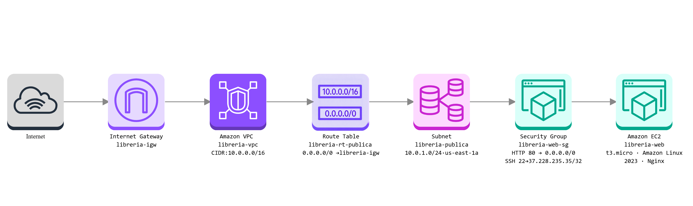

# Proyecto 1 · Mi web en AWS

## Datos del proyecto

- Alumno: Aitor Saez
- Curso: 2º DAW
- Región AWS: `us-east-1`
- Entrega: 8 de noviembre de 2026

## 1. Arquitectura

La arquitectura está formada por una VPC propia con una subred pública. El tráfico de Internet llega al Internet Gateway y se dirige a la subred mediante la tabla de rutas pública. La instancia EC2 está protegida por un grupo de seguridad.

Componentes:

- VPC `libreria-vpc`: red `10.0.0.0/16`.
- Subred pública `libreria-publica`: red `10.0.1.0/24` en `us-east-1a`.
- Internet Gateway `libreria-igw`.
- Tabla de rutas `libreria-rt-publica` con `0.0.0.0/0` hacia el Internet Gateway.
- Grupo de seguridad `libreria-web-sg`.
- Instancia EC2 `libreria-web`.

## 2. Nivel básico

### B1. Red

- VPC: `libreria-vpc` (`10.0.0.0/16`)
- Subred pública: `libreria-publica` (`10.0.1.0/24`, `us-east-1a`)
- Internet Gateway: `libreria-igw`
- Tabla de rutas: `libreria-rt-publica`
- Ruta pública: `0.0.0.0/0` hacia `libreria-igw`
- La subred tiene asignación automática de IP pública activada.

La subred es pública porque su tabla de rutas contiene una ruta `0.0.0.0/0` hacia el Internet Gateway y la instancia recibe una dirección IPv4 pública.

### B2. Seguridad

- Grupo: `libreria-web-sg`
- HTTP: puerto 80 desde cualquier IPv4.
- SSH: puerto 22 únicamente desde la IP pública del alumno.

HTTP está abierto porque cualquier usuario debe poder visitar la web. SSH está limitado a la IP pública del alumno para reducir la superficie de acceso administrativo.

### B3. Servidor web

- Nombre: `libreria-web`
- IP pública actual: `34.226.148.78`
- URL pública actual: http://34.226.148.78
- IP privada: `10.0.1.51`
- Sistema: Amazon Linux 2023
- Tipo: `t3.micro`
- Servidor web: Nginx
- Estado: Running
- Comprobaciones: 3/3 passed
- Página verificada en el navegador: sí

El script de datos de usuario instala Nginx, lo activa al arrancar y crea la página HTML de Librería Tinta con el horario, la dirección, una recomendación de lectura, el nombre del servidor y la fecha de despliegue.

### B4. Costes

- Enlace de AWS Pricing Calculator: https://calculator.aws/#/estimate?id=2b81ed706db56d676e600eecc167b6c324975ddd
- Coste mensual estimado: 8,23 USD/mes (98,76 USD/año).
- Configuración estimada: 1 instancia `t3.micro`, Linux, 730 horas/mes y 8 GiB gp3.
- Medida de ahorro: detener la instancia cuando no se utilice, teniendo en cuenta que el almacenamiento puede seguir generando costes.

## 3. Pruebas

- URL pública verificada: http://34.226.148.78
- Conexión SSH: verificada con `ec2-user` usando `labsuser.pem`.
- Nombre interno del servidor: `ip-10-0-1-51.ec2.internal`.
- Nginx: `active (running)`.
- Capturas: carpeta `img/`.

Capturas de la entrega:

- `01-vpc-libreria-vpc.png`
- `02-subred-libreria-publica.png`
- `03-internet-gateway.png`
- `04-ruta-publica.png`
- `05-asociacion-tabla-subred.png`
- `06-grupo-seguridad.png`
- `07-instancia-running.png`
- `08-web-funcionando.png`
- `09-conexion-ssh-nginx.png`
- `10-calculo-costes.png`
- `diagrama-arquitectura.png`
- `11-dns-vpc.png`
- `12-instancias-medio.png`
- `13-ip-privada-servidor-1.png`
- `14-ip-privada-servidor-2.png`
- `15-registros-dns-ponderados.png`
- `16-comprobacion-dns.png`
- `17-costes-nivel-medio.png`
- `18-despliegue-cli.png`
- `19-web-desplegada-cli.png`

## 4. Nivel medio

Completado.

- Servidor 1: `libreria-web`, IP privada `10.0.1.51`.
- Servidor 2: `libreria-web-2`, IP privada `10.0.1.67`.
- Ambas instancias están en `libreria-vpc`, `libreria-publica` y `libreria-web-sg`.
- Zona privada Route 53: `libreria.lab`.
- Nombre DNS: `web.libreria.lab`.
- Registro ponderado 1: `10.0.1.51`, identificador `servidor-1`, peso 80.
- Registro ponderado 2: `10.0.1.67`, identificador `servidor-2`, peso 20.
- Comprobación: `dig` desde `libreria-web` resolvió el nombre privado y `curl` recibió respuestas de ambas páginas.
- Coste actualizado para dos servidores y DNS: `17,36 USD/mes` (`208,32 USD/año`).
- Enlace de la estimación de nivel medio: https://calculator.aws/#/estimate?id=d0491fbcd31047f0979fce6d5742d3bab99f4f46

La prueba se realizó desde una instancia de la VPC con `dig` y varias peticiones `curl`. Las respuestas mostraron tanto `Librería Tinta` como `Librería Tinta - Servidor 2`.

## 5. Nivel avanzado

Completado mediante AWS CloudShell y AWS CLI.

- Script utilizado: `scripts/desplegar.sh`.
- Script de instalación web: `scripts/user-data1.sh`.
- El script obtiene la AMI de Amazon Linux 2023 mediante SSM.
- Crea el grupo de seguridad, autoriza HTTP 80 desde Internet y SSH 22 desde `37.228.235.35/32`.
- Lanza una instancia `t3.micro` en la subred pública usando la clave `vockey` y las etiquetas del proyecto.
- Instancia creada: `i-0ce9666d0f24e2954`.
- IP pública de prueba: `3.80.153.8`.
- La web se verificó correctamente mediante `http://3.80.153.8`.
- Tras la comprobación, la instancia se dejó detenida para evitar consumo innecesario.

## 6. Uso de IA

- Herramientas utilizadas: ChatGPT/Codex y Cloudairy AI.
- Prompts útiles:
  1. Revisar paso a paso la creación de una VPC, subred pública, Internet Gateway y tabla de rutas en AWS.
  2. Comprobar la configuración de una instancia EC2 con Amazon Linux 2023, `t3.micro`, Nginx y `user-data`.
  3. Revisar la estimación de costes de EC2 en `us-east-1`.
- Prompt usado en Cloudairy: generar un diagrama de arquitectura AWS para Librería Tinta con Internet, `libreria-igw`, `libreria-vpc`, `libreria-rt-publica`, `libreria-publica`, `libreria-web-sg` y `libreria-web`.
- Error o propuesta incorrecta detectada y corregida: la calculadora seleccionó inicialmente `t4g.nano`; se comprobó el enunciado y se corrigió a `t3.micro`. Además, el primer diagrama generado por Cloudairy mostraba rangos `172.16.x.x` y una subred dentro de la tabla de rutas; se corrigieron manualmente los iconos y las etiquetas para que coincidieran con los recursos reales de AWS.
- Revisión humana: la IA generó una primera versión, pero se verificaron todos los nombres, CIDR, rutas y reglas de seguridad manualmente antes de usar el diagrama.
- No se han compartido credenciales, claves privadas ni datos sensibles con la IA.

